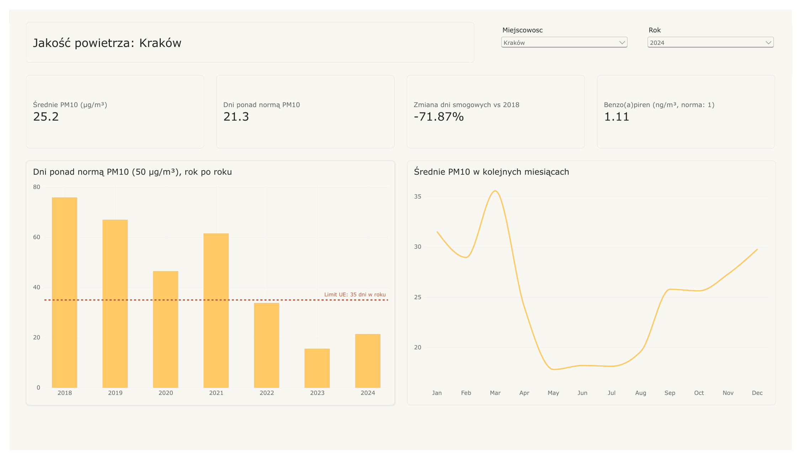
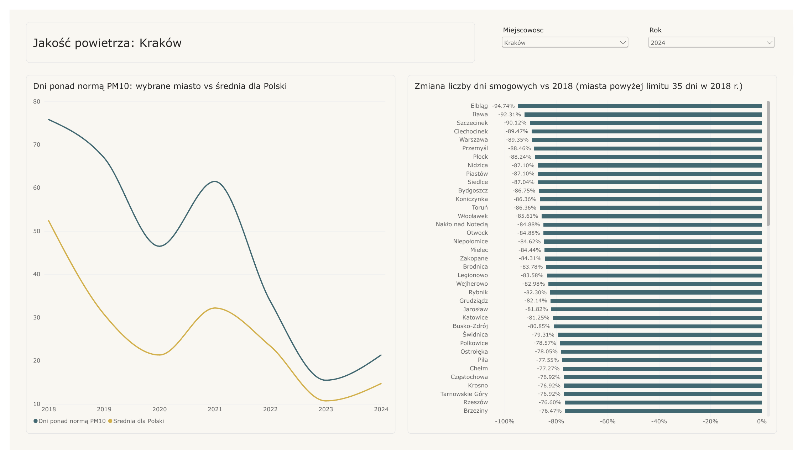
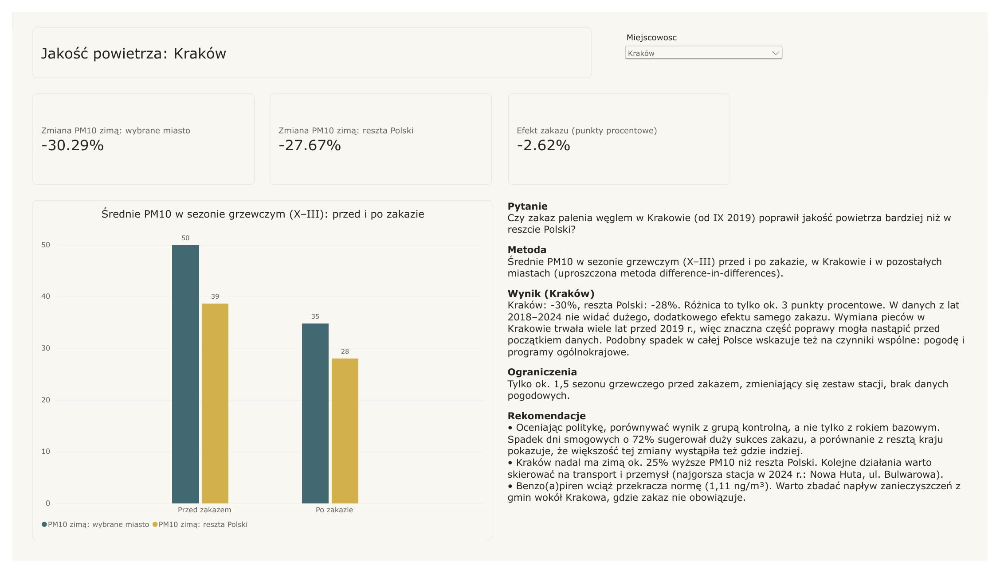
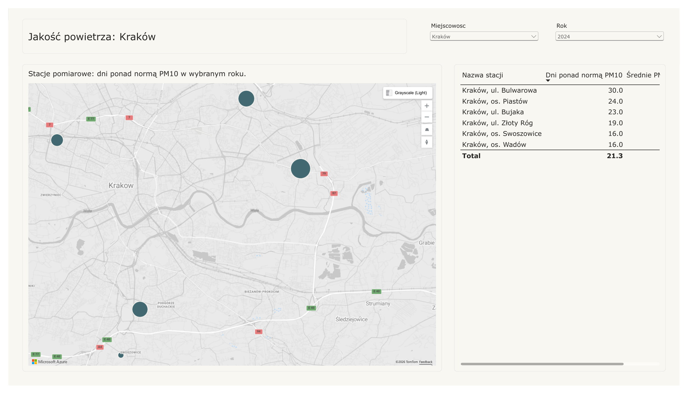
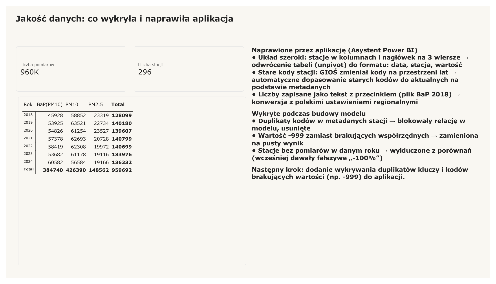

# Data Assistant for Power BI

**A tool that prepares messy data for Power BI: it detects data quality issues, proposes a cleaning plan
and generates ready-to-use Power Query (M) code.** Built with Polish data formats in mind:
Windows-1250 encoding, decimal commas, `dd.mm.yyyy` dates, postcodes, NIP (tax ID) check digits
and spelling variants with Polish characters (`Kraków` / `krakow` / `KRAKÓW`).

The interface is available in **English and Polish**.

🇵🇱 *Wersja polska poniżej.*

## How it works

1. **Upload** a CSV or Excel file. Encoding and separator are detected automatically.
2. **Quality report**: every column gets a detected type, missing values, unique counts and a list of issues.
3. **Cleaning plan**: suggested steps with checkboxes and a before/after preview.
4. **Power Query code**: paste it into Power BI (*Get data → Blank query → Advanced Editor*).
   From then on, Power BI cleans every new version of the file on refresh.

### Wide files with multi-row headers

Many official Polish datasets (e.g. air quality data from GIOŚ) are published in a *wide* layout:
several header rows and one column per measuring station. The app detects this automatically,
**unpivots** the table into a long format (one row per date and station) and generates the matching
Power Query steps (`Table.UnpivotOtherColumns`).

It can also **check codes against a dictionary** (e.g. station metadata). GIOŚ has renamed some stations
over the years: in the 2019 PM10 file, 16 of 179 station codes are missing from the current metadata -
6 can be matched through the *old code* column, 10 cannot be matched at all. Without this check those
measurements would silently disappear when filtering by city in Power BI.

## Project structure

| File | Purpose |
|---|---|
| `app.py` | user interface (Streamlit) |
| `loading.py` | file loading, encoding and separator detection |
| `profiling.py` | column profiling and data quality rules |
| `cleaning.py` | cleaning steps (pandas) and Power Query code generation (M) |
| `reshape.py` | wide-layout detection, unpivot and dictionary (lookup) checks |
| `i18n.py` | English and Polish texts |
| `tests/` | automated tests (pytest) |
| `data/generate_test_data.py` | generator of messy test data |
| `smog.pbix` | Power BI dashboard (GIOŚ air quality data) |
| `docs/` | dashboard screenshots and PDF |

## Result in Power BI

The generated code runs in Power BI Desktop without errors - every column passes the *Column quality* check
with **0% errors**:


Each cleaning step appears as a named step in *Applied Steps*:


## Power BI dashboard: air quality in Polish cities (GIOŚ, 2018-2024)

The app was used to prepare **~960,000 daily measurements from 296 stations** (PM10, PM2.5 and
benzo(a)pyrene) published by GIOŚ, the Polish Chief Inspectorate of Environmental Protection.
The report is in [`smog.pbix`](smog.pbix) (Power BI Desktop), and all pages are also available as a
[PDF](docs/smog-dashboard.pdf). City and year are selected with slicers, so every page works for any city.

### 1. Overview


### 2. City vs national average


### 3. Analysis: did the coal ban in Kraków work?


**Question.** Did the ban on burning coal and wood in Kraków (in force since September 2019) improve air
quality more than in the rest of Poland?

**Method.** Average PM10 in the **heating season** (October-March, when the ban matters) **before and after
the ban**, in Kraków and in all other cities. The difference between the two changes is the estimated
effect of the ban - a simplified *difference-in-differences* design, with the rest of Poland as the control group.

| Heating-season PM10 (µg/m³) | Before the ban | After the ban | Change |
|---|---|---|---|
| Kraków | 50 | 35 | **-30%** |
| Rest of Poland | 39 | 28 | **-28%** |
| **Estimated effect of the ban** | | | **≈ -2.6 percentage points** |

**Interpretation.** Kraków improved only slightly more than the rest of the country, so the 2018-2024 data
shows no large additional effect of the ban itself. Kraków had been replacing coal stoves for years before
2019, so much of the improvement probably happened before this data starts. The similar drop across Poland
points to common factors as well: weather and nationwide programmes.

**Limitations.** Only about 1.5 heating seasons before the ban, a changing set of stations, no weather data.

**Recommendations**
- **Evaluate policies against a control group, not only a base year.** The 72% drop in smog days looked like
  a big success of the ban, but most of that change happened elsewhere too.
- **Kraków still has ~25% higher winter PM10 than the rest of Poland.** Further action could target transport
  and industry - the worst station in 2024 was ul. Bulwarowa in Nowa Huta, the industrial district.
- **Benzo(a)pyrene is still above the 1 ng/m³ target (1.11 ng/m³ in 2024).** Pollution drifting in from municipalities
  around Kraków, where the ban does not apply, is worth investigating.

### 4. Station map


### 5. Data quality


### Key findings (Kraków)

- **Days above the PM10 daily limit (50 µg/m³) fell from ~76 in 2018 to ~21 in 2024 (-72%).**
  Since 2022 Kraków has stayed below the EU limit of 35 days per year.
- **The national average fell by a similar proportion** (see the analysis above), and many cities improved even more
  (Elbląg -95%, Warszawa -89%, Katowice -81%). The 2019 ban on solid-fuel heating in Kraków was
  probably not the only driver: weather and nationwide programmes matter too.
- Air quality follows the **heating season**: monthly PM10 is roughly twice as high in winter as in summer.
- In 2024 the worst station was **ul. Bulwarowa** (Nowa Huta, industrial district) with 30 days above the limit.
- **Benzo(a)pyrene is still above the 1 ng/m³ target** (1.11 ng/m³ in 2024).

### Data model and DAX

- Star schema: `Pomiary` (fact table, measurements) with `Stacje` (stations) and `Kalendarz` (date table) as dimensions.
- Power Query: one function (`fnGios`) loads every yearly file from a folder, unpivots it and maps
  old station codes to current ones.
- DAX measures: average per station (`AVERAGEX`), comparison with 2018 (`CALCULATE` + `REMOVEFILTERS`),
  national benchmark that ignores the city filter, a dynamic page title (`SELECTEDVALUE`).
- Comparisons return blank when one of the years has no data, so closed stations do not show a false "-100%".

## Design decisions

- **Rules first, no black box.** Profiling and cleaning are plain, deterministic Python rules.
  The same rule always gives the same result, and every step can be explained.
- **Everything is read as text.** pandas guesses types by default and can silently corrupt data
  (e.g. strip leading zeros). Types are detected in a controlled way instead.
- **One step, two implementations.** Each cleaning step exists in pandas (for the preview) and in M
  (for Power BI), so the preview matches what Power BI produces.
- **The analyst decides.** Outliers are reported but never removed automatically - a 400-item order
  may be an error or a genuine large order.

## Run locally

```bash
python3 -m venv .venv
source .venv/bin/activate          # Windows: .venv\Scripts\activate
pip install -r requirements.txt

python data/generate_test_data.py  # creates a deliberately messy sample file
streamlit run app.py               # opens the app in your browser
python -m pytest                   # runs the automated tests
```

### Air quality data (GIOŚ)

Raw files are not stored in the repository (they are large). Download the yearly archives from
[powietrze.gios.gov.pl/pjp/archives](https://powietrze.gios.gov.pl/pjp/archives), unzip them and place
the `PM10_24g`, `PM25_24g` and `BaP(PM10)_24g` files plus the station metadata in `data/gios/`.

## Known limitations

- Dates written with slashes are read as day/month/year (Polish and European convention).
  US-style month/day dates are not supported - `03/05/2025` cannot be told apart from 3 May.
- Wide-layout detection works for Excel files whose first column contains dates.

## Roadmap

- [x] Data quality report with Polish-specific rules
- [x] Cleaning plan with before/after preview
- [x] Power Query code generation, tested in Power BI Desktop
- [x] English and Polish interface
- [x] Wide files with multi-row headers (unpivot) and dictionary checks
- [x] Power BI dashboard: air quality in Kraków vs other Polish cities (GIOŚ data, 2018-2024)
- [ ] Detection of duplicate keys and numeric missing-value codes (e.g. -999)
- [ ] AI suggestions for additional cleaning steps (e.g. filling a missing city from the postcode)

---

## 🇵🇱 Wersja polska

**Asystent danych dla Power BI** to narzędzie, które przygotowuje „brudne” dane do Power BI: wykrywa problemy
z jakością danych, proponuje plan czyszczenia i generuje gotowy kod Power Query (M). Powstało z myślą
o polskich formatach danych: kodowaniu Windows-1250, przecinku dziesiętnym, datach `dd.mm.rrrr`, kodach
pocztowych, cyfrze kontrolnej NIP i wariantach nazw z polskimi znakami (`Kraków` / `krakow` / `KRAKÓW`).
Interfejs jest dostępny po polsku i po angielsku.

### Jak to działa

1. **Wczytanie** pliku CSV lub Excel. Kodowanie i separator są wykrywane automatycznie.
2. **Raport jakości**: dla każdej kolumny wykryty typ, braki danych, liczba unikalnych wartości i lista problemów.
3. **Plan czyszczenia**: proponowane kroki do zaznaczenia oraz podgląd danych przed i po.
4. **Kod Power Query**: wklejasz go w Power BI (*Pobierz dane → Puste zapytanie → Edytor zaawansowany*).
   Od tej chwili Power BI czyści każdą nową wersję pliku przy odświeżeniu.

Aplikacja obsługuje też pliki w **układzie szerokim** z nagłówkiem na kilka wierszy (tak publikuje dane m.in.
GIOŚ): sama odwraca tabelę do układu „długiego” i generuje odpowiednie kroki Power Query. Potrafi również
**sprawdzić kody ze słownikiem**, np. z metadanymi stacji. GIOŚ z czasem zmieniał kody stacji: w pliku PM10
z 2019 r. 16 ze 179 kodów nie występuje w aktualnych metadanych. 6 z nich da się dopasować po starym kodzie,
a 10 nie ma nigdzie. Bez tej kontroli te pomiary po cichu znikałyby przy filtrowaniu po mieście.

Wygenerowany kod został przetestowany w Power BI Desktop: wszystkie kolumny przechodzą kontrolę
*Column quality* z wynikiem **0% błędów**.

### Dashboard Power BI: jakość powietrza w polskich miastach (GIOŚ, 2018-2024)

Za pomocą aplikacji przygotowałam **ok. 960 tys. dobowych pomiarów z 296 stacji** (PM10, PM2.5
i benzo(a)piren). Dashboard ([`smog.pbix`](smog.pbix), wersja PDF: [docs/smog-dashboard.pdf](docs/smog-dashboard.pdf))
ma pięć stron, a miasto i rok wybiera się filtrami, więc każda strona działa dla dowolnego miasta:

1. **Przegląd**: średnie PM10, liczba dni ponad normą, zmiana względem 2018 r., benzo(a)piren i sezonowość.
2. **Na tle Polski**: wybrane miasto na tle średniej krajowej i ranking poprawy miast.
3. **Czy zakaz zadziałał?**: analiza „przed i po” z grupą kontrolną (opis niżej).
4. **Mapa stacji**: stacje w wybranym mieście i liczba dni ponad normą na każdej z nich.
5. **Jakość danych**: co trzeba było poprawić w danych źródłowych i co wykryła aplikacja.

### Analiza: czy zakaz palenia węglem w Krakowie zadziałał?

**Pytanie.** Czy zakaz palenia węglem i drewnem w Krakowie (od września 2019 r.) poprawił jakość powietrza
bardziej niż w reszcie Polski?

**Metoda.** Średnie PM10 w **sezonie grzewczym** (październik–marzec, bo wtedy zakaz ma znaczenie) **przed
i po zakazie**, w Krakowie i w pozostałych miastach. Różnica między tymi dwiema zmianami to szacowany efekt
zakazu (uproszczona metoda *difference-in-differences*, z resztą Polski jako grupą kontrolną).

| PM10 w sezonie grzewczym (µg/m³) | Przed zakazem | Po zakazie | Zmiana |
|---|---|---|---|
| Kraków | 50 | 35 | **-30%** |
| Reszta Polski | 39 | 28 | **-28%** |
| **Szacowany efekt zakazu** | | | **ok. -2,6 punktu procentowego** |

**Interpretacja.** Kraków poprawił się tylko nieco bardziej niż reszta kraju, więc w danych z lat 2018-2024
nie widać dużego, dodatkowego efektu samego zakazu. Wymiana pieców w Krakowie trwała wiele lat przed 2019 r.,
więc znaczna część poprawy mogła nastąpić przed początkiem danych. Podobny spadek w całej Polsce wskazuje też
na czynniki wspólne: pogodę i programy ogólnokrajowe.

**Ograniczenia.** Tylko ok. 1,5 sezonu grzewczego przed zakazem, zmieniający się zestaw stacji, brak danych pogodowych.

**Rekomendacje**
- **Oceniać politykę przez porównanie z grupą kontrolną, a nie tylko z rokiem bazowym.** Spadek dni smogowych
  o 72% wyglądał na duży sukces zakazu, ale większość tej zmiany wystąpiła też w innych miastach.
- **Kraków nadal ma zimą ok. 25% wyższe PM10 niż reszta Polski.** Kolejne działania warto skierować na transport
  i przemysł: najgorszą stacją w 2024 r. była ul. Bulwarowa w Nowej Hucie.
- **Benzo(a)piren wciąż przekracza normę 1 ng/m³ (1,11 ng/m³ w 2024 r.).** Warto zbadać napływ zanieczyszczeń
  z gmin wokół Krakowa, gdzie zakaz nie obowiązuje.

### Najważniejsze wnioski (Kraków)

- Liczba dni z przekroczeniem dobowej normy PM10 (50 µg/m³) spadła z ok. 76 w 2018 r. do ok. 21 w 2024 r. (-72%).
  Od 2022 r. Kraków mieści się w unijnym limicie 35 dni w roku.
- Średnia dla całej Polski spadła w podobnym stopniu, a wiele miast poprawiło się jeszcze bardziej
  (Elbląg -95%, Warszawa -89%, Katowice -81%).
- Jakość powietrza wyraźnie zależy od **sezonu grzewczego**: zimą średnie PM10 jest mniej więcej dwa razy wyższe niż latem.

### Uruchomienie

```bash
python3 -m venv .venv
source .venv/bin/activate          # Windows: .venv\Scripts\activate
pip install -r requirements.txt

python data/generate_test_data.py  # tworzy celowo „brudny” plik testowy
streamlit run app.py               # otwiera aplikację w przeglądarce
python -m pytest                   # uruchamia testy automatyczne
```

Surowe pliki GIOŚ nie są przechowywane w repozytorium (są duże). Archiwa roczne można pobrać ze strony
[powietrze.gios.gov.pl/pjp/archives](https://powietrze.gios.gov.pl/pjp/archives), rozpakować i umieścić pliki
`PM10_24g`, `PM25_24g` i `BaP(PM10)_24g` oraz metadane stacji w folderze `data/gios/`.
