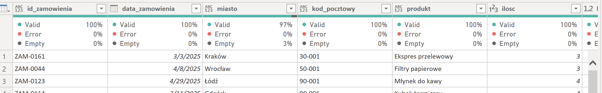
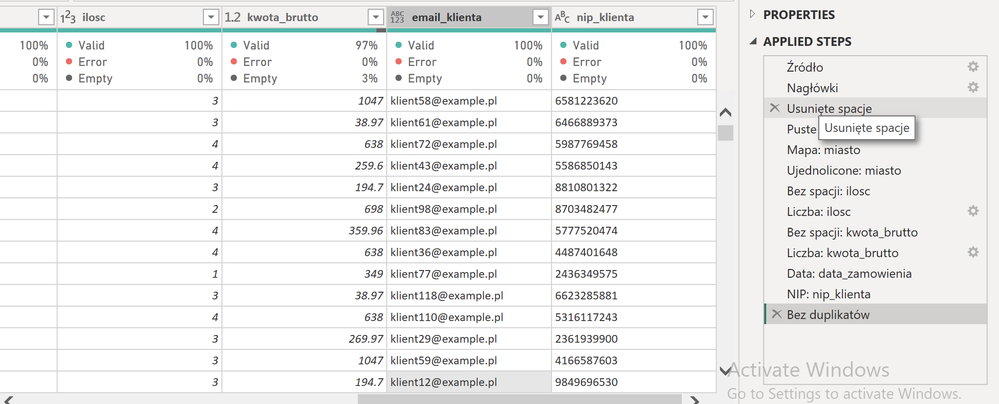

# Data Assistant for Power BI

**A tool that prepares messy data for Power BI: it detects data quality issues, proposes a cleaning plan
and generates ready-to-use Power Query (M) code.** Built with Polish data formats in mind:
Windows-1250 encoding, decimal commas, `dd.mm.yyyy` dates, postcodes, NIP (tax ID) check digits
and spelling variants with Polish characters (`Kraków` / `krakow` / `KRAKÓW`).

The interface is available in **English and Polish**.

🇵🇱 *Wersja polska poniżej.*

## How it works

1. **Upload** a CSV or Excel file. Encoding and separator are detected automatically.
2. **Quality report**: every column gets a detected type, missing values, unique counts and a list of issues.
3. **Cleaning plan**: suggested steps with checkboxes and a before/after preview.
4. **Power Query code**: paste it into Power BI (*Get data → Blank query → Advanced Editor*).
   From then on, Power BI cleans every new version of the file on refresh.

## Result in Power BI

The generated code runs in Power BI Desktop without errors - every column passes the *Column quality* check
with **0% errors**:



Each cleaning step appears as a named step in *Applied Steps*:



## Design decisions

- **Rules first, no black box.** Profiling and cleaning are plain, deterministic Python rules.
  The same rule always gives the same result, and every step can be explained.
- **Everything is read as text.** pandas guesses types by default and can silently corrupt data
  (e.g. strip leading zeros). Types are detected in a controlled way instead.
- **One step, two implementations.** Each cleaning step exists in pandas (for the preview) and in M
  (for Power BI), so the preview matches what Power BI produces.
- **The analyst decides.** Outliers are reported but never removed automatically - a 400-item order
  may be an error or a genuine large order.

## Run locally

```bash
python3 -m venv .venv
source .venv/bin/activate          # Windows: .venv\Scripts\activate
pip install -r requirements.txt

python data/generate_test_data.py  # creates a deliberately messy sample file
streamlit run app.py               # opens the app in your browser
python -m pytest                   # runs the automated tests
```

## Project structure

| File | Purpose |
|---|---|
| `app.py` | user interface (Streamlit) |
| `loading.py` | file loading, encoding and separator detection |
| `profiling.py` | column profiling and data quality rules |
| `cleaning.py` | cleaning steps (pandas) and Power Query code generation (M) |
| `i18n.py` | English and Polish texts |
| `tests/` | automated tests (pytest) |
| `data/generate_test_data.py` | generator of messy test data |

## Roadmap

- [x] Data quality report with Polish-specific rules
- [x] Cleaning plan with before/after preview
- [x] Power Query code generation, tested in Power BI Desktop
- [x] English and Polish interface
- [ ] Power BI sales dashboard built on the cleaned data
- [ ] AI suggestions for additional cleaning steps (e.g. filling a missing city from the postcode)

---

## 🇵🇱 Wersja polska

**Asystent danych dla Power BI** wykrywa problemy z jakością danych, proponuje plan czyszczenia
i generuje gotowy kod Power Query. Szczególny nacisk położony jest na polskie formaty danych:
kodowanie Windows-1250, przecinek dziesiętny, daty `dd.mm.rrrr`, kody pocztowe, cyfrę kontrolną NIP
oraz warianty nazw z polskimi znakami.

Kod wygenerowany przez aplikację został przetestowany w Power BI Desktop: wszystkie kolumny
przechodzą kontrolę *Column quality* z wynikiem **0% błędów**.

Instrukcja uruchomienia i opis plików znajdują się w części angielskiej powyżej.
